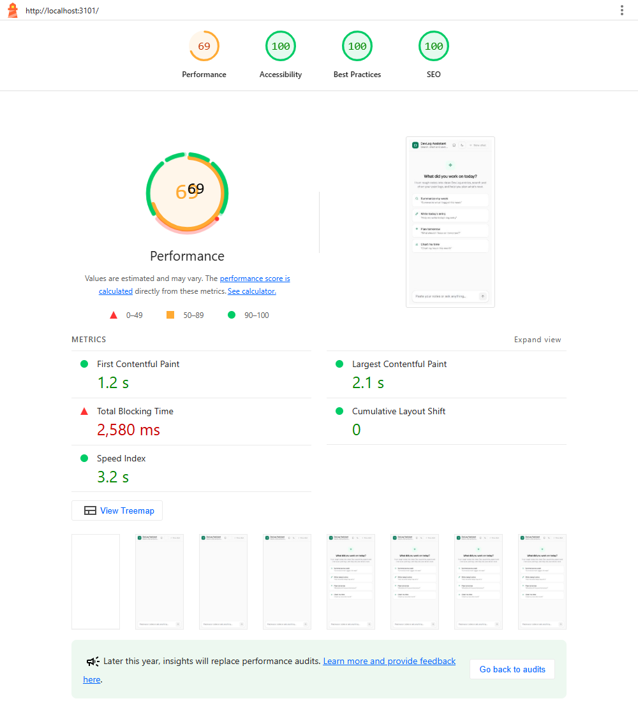
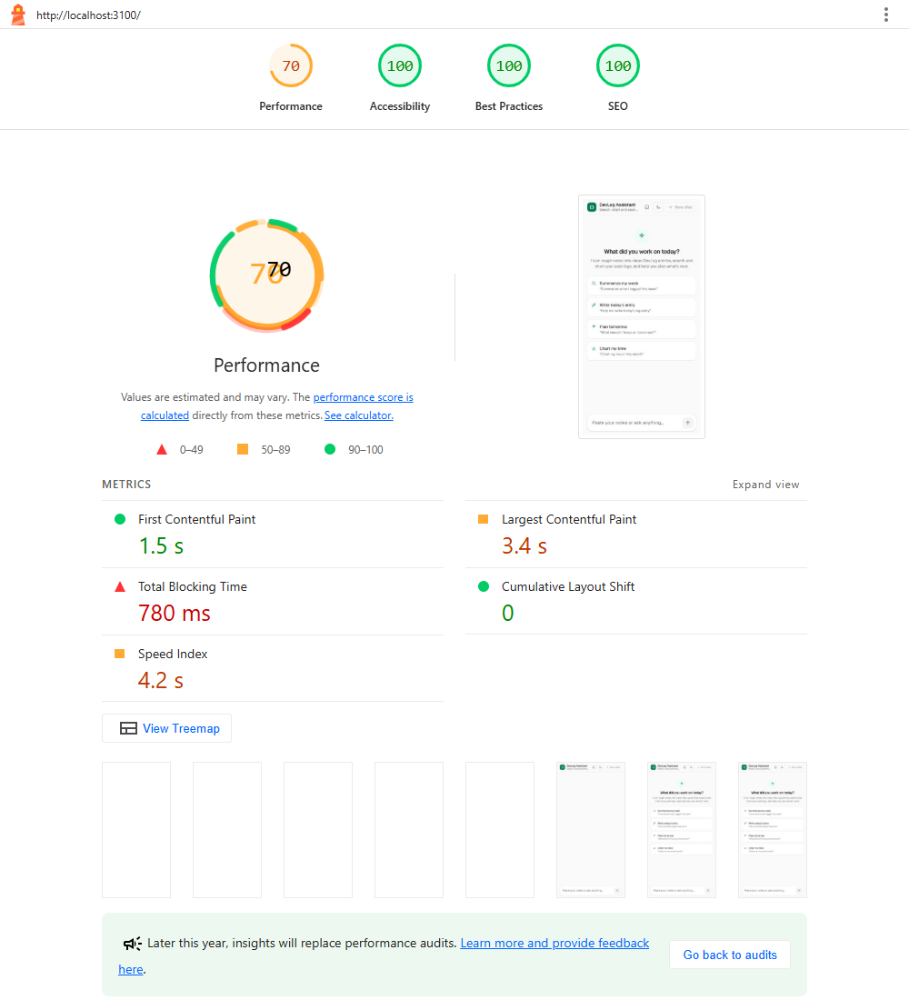

# Accessibility & Performance Audit (Week 7)

The app audited is **DevLog Assistant**, my AI chat app from Week 6
(`Week6_Task/Testing_Pass`), copied into this folder and fixed here.

## How I tested

| Check | Tool | Setup |
| --- | --- | --- |
| Lighthouse | Lighthouse 12.8 (CLI, **mobile preset**: Moto G Power, slow 4G, 4× CPU slowdown) | `next build` + `next start` with `CHAT_PROVIDER=mock`, 3 runs per page, median kept |
| Automated a11y (WAVE-style) | axe-core 4 (WCAG 2.0/2.1/2.2 A + AA + best-practice rules) | 412 px mobile viewport, **light and dark** theme, empty chat **and** a chat with streamed replies + tool cards |
| Keyboard | Scripted keyboard-only run (Puppeteer) + manual check | Full flow: example prompt → send → **Stop** → send again → Regenerate → Logs |

Pages audited: `/` (chat), `/logs`, `/states` (every tool-card state).

Full reports: `audit/before/*.html` and `audit/after/*.html` (open in a browser),
axe results in `audit/*/axe.json`.

## Before

| Page | Performance | Accessibility | Best practices | SEO | LCP | TBT | CLS |
| --- | --- | --- | --- | --- | --- | --- | --- |
| Chat `/` | **62** | 100 | 100 | 100 | 4.2 s | 980 ms | 0 |
| Logs `/logs` | **79** | 100 | 100 | 100 | 2.8 s | 690 ms | 0 |
| Tool states `/states` | **76** | **92** | 100 | 100 | 3.0 s | 740 ms | 0 |

*(First baseline run, when the machine was quiet: CPU benchmark index 928.)*

**axe-core: 7 different problems** (WAVE would call these errors and contrast errors):

| # | Problem | Where | Impact |
| --- | --- | --- | --- |
| 1 | `aria-label` on chart bars (`<rect>`) with no role | Stats chart (chat + states) | serious |
| 2 | Grey text on the light-red error background: **4.41:1** (needs 4.5) | Tool error cards | serious |
| 3 | Model name under replies faded to 70%: **2.68:1** light / **4.22:1** dark | Every reply | serious |
| 4 | Cancelled save card faded with `opacity-60`: **2.26:1** | Save tool, cancelled state | serious |
| 5 | Two tool cards with the same name made duplicate landmarks | Tool cards | moderate |
| 6 | Scrollable JSON boxes couldn't be reached with the keyboard | `/states` | serious |
| 7 | Partial (failed) replies faded to 70%, so muted text failed contrast | Chat error state | serious |

**What was already good:** landmarks (`header`/`nav`/`main`/`footer`), a hidden
`h1`, a labelled message box, visible focus rings, 44 px tap targets,
reduced-motion support, no images without alt text, CLS 0.

**Main performance problem:** the chat page downloaded **Streamdown**
(markdown + code highlighting + Mermaid, ~470 KB) on first load, even though a
new chat shows only the welcome screen. `/logs` and `/states` also downloaded and
ran the chat page's JavaScript, because the header links prefetched `/`.

## What I changed

### Accessibility

| Fix | File |
| --- | --- |
| Chart bars get `role="img"` (so their `aria-label` is valid); the chart `<svg>` becomes `role="group"` so the bars stay reachable | `components/tools/LogStatsTool.tsx` |
| Light-theme `--muted-foreground` `#71717a` → `#67676f`: now **≥ 5.1:1 on every light background** (white, muted, red error, green) | `app/globals.css` |
| Model name: removed `/70` opacity (now 5.4:1 light, 7.8:1 dark) | `components/chat/Message.tsx` |
| Cancelled save card: no opacity; a dashed border + struck-through title show it wasn't saved | `components/tools/SaveEntryTool.tsx` |
| Partial replies: no opacity; the "Incomplete response" badge marks them | `components/chat/Message.tsx` |
| Tool cards: `<section aria-label>` (a landmark) → `<article aria-label>` (labelled, not a landmark) | `components/tools/ToolCard.tsx` |
| JSON boxes: `tabIndex={0}`, a label and a focus ring | `components/tools/StatesGallery.tsx` |

### AI-specific accessibility

- **Streamed output, announced politely.** Before, the whole conversation was an
  `aria-live` region, so a screen reader could read every streamed chunk. Now the
  conversation is a `role="log"` with `aria-live="off"`. A hidden
  `role="status" aria-live="polite" aria-atomic="true"` region says:
  - "Assistant is replying…" when the stream starts
  - **the whole reply once, as plain text** when it finishes (markdown
    symbols removed, code blocks read as "(code block)")
  - "Response stopped." after Stop

  Errors still use `role="alert"` (Week 5).
  Code: `useReplyAnnouncement()` in `components/chat/Chat.tsx`.
- **Stop button:** a real `<button aria-label="Stop generating">`. One Tab from
  the message box reaches it while a reply streams. It has a focus ring, and
  **Esc** also stops. After stopping, focus goes back to the message box.

### Performance

| Fix | File | Effect |
| --- | --- | --- |
| Streamdown moved to `Markdown.tsx` and loaded with `React.lazy`. It starts downloading when you press Send (`preloadMarkdown()`); until it arrives the text shows as plain lines in the same font size (no layout shift) | `components/chat/Markdown.tsx`, `Message.tsx`, `Chat.tsx` | ~470 KB (raw) off the chat page's first load |
| `prefetch={false}` on header links and the `/states` back link (Next.js still prefetches on hover/touch) | `components/chat/ChatHeader.tsx`, `StatesGallery.tsx` | `/logs` and `/states` no longer download or run the chat's AI SDK + zod bundle (~330 KB raw) while loading |

Tried and **reverted**, because re-measuring showed no gain:
- `experimental.inlineCss`: LCP got worse (bigger HTML).
- A modern `browserslist`: Lighthouse's "legacy JavaScript" stayed at 13 KiB.

## After

### Accessibility (stable, does not depend on the machine)

| Page | Lighthouse a11y before → after | axe violations before → after (light + dark) |
| --- | --- | --- |
| Chat `/` (empty) | 100 → **100** | 0 → **0** |
| Chat with replies + tool cards | not scored | 2–3 types → **0** |
| Logs `/logs` | 100 → **100** | 0 → **0** |
| Tool states `/states` | **92 → 100** | 4 types (30+ nodes) → **0** |

axe "needs review" items are left: contrast on text over gradients/animations,
and the chart rects. I checked them by hand: the text uses the same tokens as
above, and the rects now have `role="img"`.

### JavaScript sent on first load (from Lighthouse, transferred/gzipped)

| Page | JS before | JS after | Change | Unused JS before → after |
| --- | --- | --- | --- | --- |
| Chat `/` | 397 KiB | **255 KiB** | **−36%** | 195 → 118 KiB |
| Logs `/logs` | 401 KiB | **259 KiB** | **−35%** | 254 → 116 KiB |
| Tool states `/states` | 400 KiB | **163 KiB** | **−59%** | 254 → 52 KiB |

### Lighthouse performance (mobile)

Best clean "after" run (machine idle), compared with the clean "before" run above:

| Page | Perf before → after | TBT before → after | LCP before → after |
| --- | --- | --- | --- |
| Chat `/` | 62 → **78** | 980 → **500 ms** | 4.2 → **3.2 s** |
| Logs `/logs` | 79 → **85** | 690 → **450 ms** | 2.8 → **2.7 s** |
| Tool states `/states` | 76 → **81** | 740 → **600 ms** | 3.0 → **2.7 s** |

CLS stayed **0** on every page. Best practices and SEO stayed 100.

> **Honest note on these numbers.** Lighthouse slows the CPU down 4× from
> whatever this laptop is doing. During later runs, other apps (Chrome, VS
> Code) kept the CPU at ~85%, and Lighthouse's CPU benchmark dropped from 928
> to as low as 350. Scores for the **same build** then moved by ±10 points.
> The screenshots in `audit/screenshots/` are from back-to-back before/after
> runs under that load. The byte counts above don't depend on CPU and are the
> reliable delta.

## Still open (to reach 90+ performance)

1. **Measure on the deployed preview** with PageSpeed Insights (consistent
   hardware). Local Lighthouse on a busy laptop under-reports.
2. **Hydration** is now the biggest cost: React's long task is ~350–500 ms at
   4× slowdown. Next step: render the welcome screen on the server (today it
   waits for localStorage), so LCP doesn't wait for hydration.
3. **AI SDK + zod (~330 KB raw)** still loads on the chat page. Next step: load
   `useChat` on first focus of the message box.

## Rubric checklist

- [x] Lighthouse **accessibility 100** on all audited pages (was 92 on `/states`)
- [ ] Lighthouse **performance 90+**: improved (62 → 78 chat, 79 → 85 logs, 76 → 81 states), still under 90 locally; see "Still open"
- [x] **0 axe/WCAG errors** on all audited pages, light + dark, including a chat with streamed replies
- [x] Primary flow **completable by keyboard alone**, including Stop (Tab or Esc) and Regenerate
- [x] Streamed output announced **politely, once** (`aria-live="polite"`); Stop is a keyboard-reachable button
- [x] Tests still pass: **55/55** unit tests (tool-card queries changed from `region` to `article`; the markdown test waits for the lazy renderer)
