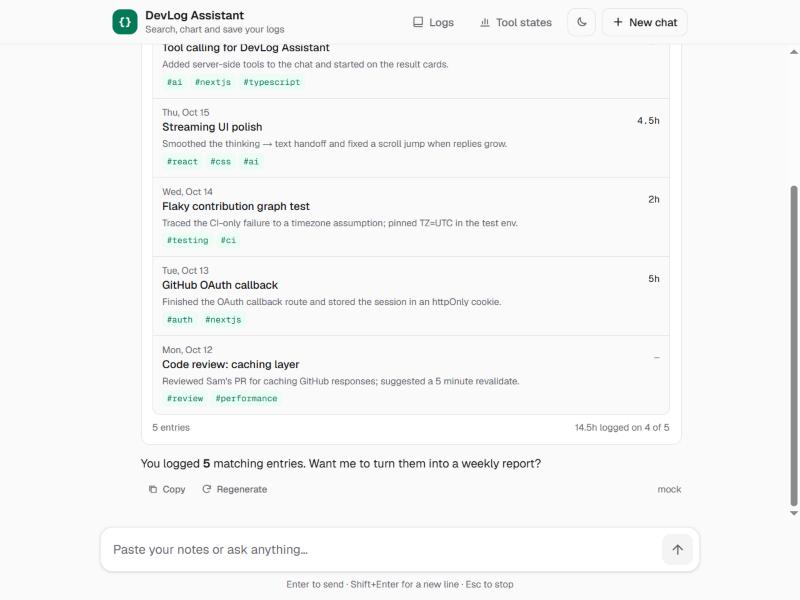
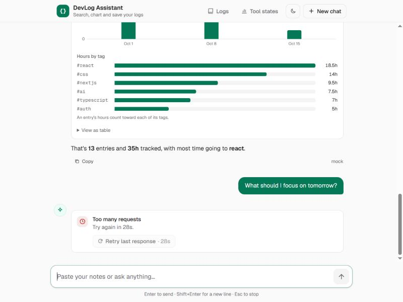
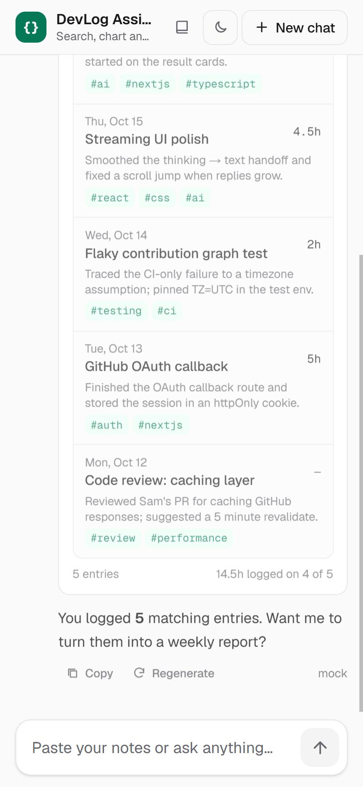

# DevLog Assistant

An AI chat for **DevLog**, a daily work journal for developers. Paste rough
notes and it writes a clean log entry. It can also search your past entries,
chart your hours, and save a new entry once you approve it. Replies stream in
as they're written, and tool results show up as cards.

**Live:** https://REPLACE-WITH-PRODUCTION-URL.vercel.app <!-- TODO: paste after `vercel --prod` -->

| Chat | Rate limited | Phone |
| --- | --- | --- |
|  |  |  |

## Run it

Needs Node.js 20.9+.

```bash
npm install
```

```bash
npm run dev
```

Open http://localhost:3000. You don't need an API key: without one, a built-in
mock model answers. To use a real model, copy `.env.example` to `.env.local`
and add one key.

Tests: `npm run test:run` (66 unit tests) and `npm run test:e2e` (4 browser
tests). No test calls a real AI API.

## Environment variables

All of them are server-only.

| Variable | Default | Purpose |
| --- | --- | --- |
| `ANTHROPIC_API_KEY` or `GEMINI_API_KEY` | – | **One is required in production.** Claude wins if both are set. |
| `ANTHROPIC_MODEL` / `GEMINI_MODEL` | `claude-opus-5` / `gemini-flash-lite-latest` | Model id |
| `CHAT_RATE_LIMIT_PER_MINUTE` | `10` | Requests per IP per minute |
| `CHAT_RATE_LIMIT_PER_DAY` | `100` | Requests per IP per day |
| `CHAT_DAILY_BUDGET` | `1000` | Requests per day for the whole app |
| `NEXT_PUBLIC_ENABLE_SABOTAGE` | – | Dev only: forces failure states. **Never set in production.** |

The full list is in [`.env.example`](.env.example).

## How it works

```
Chat UI (useChat) ──POST /api/chat──▶ checks ──▶ streamText(Claude | Gemini | mock, tools)
        ◀──────── streamed text + tool cards ────────┘
```

Before any model call, `app/api/chat/route.ts` rejects requests from other
sites (403), bodies over 1M characters (413), messages over 8,000 characters
(400), and IPs over their limit (429, and the UI counts down until you can
retry). Only the last 40 messages go to the model, and `maxDuration` is
60 seconds. The limiter (`lib/ai/rate-limit.ts`) keeps its counts in memory,
so it isn't shared across server instances. A spend limit in the provider
console is the backstop.

**Key decisions:** Vercel AI SDK, so one code path serves Claude, Gemini and
the mock. A fallback model is tried once when the main one is busy. Saving an
entry needs your approval. Tests find elements by role and label, never by
test ID.

## How AI tools built this

I built this with **Claude Code**. I wrote the briefs and reviewed every
change; it wrote most of the code and checked it in the browser. Some
specifics:

- **Week 6:** I deleted `aria-invalid` from the composer on purpose. It ran
  the tests, saw the failure, and fixed the code, not the test.
- **Week 8:** It found that `maxDuration` and the length caps already existed,
  so it added only the per-IP limiter. It reused the existing `rate_limited`
  error, which meant the UI needed no changes.
- **Its mistakes:** Its first limiter test timed out because it read three
  full streamed replies. It also nearly used Lighthouse reports as app
  screenshots. And it found 2 browser tests that had been broken since
  Week 7's accessibility changes.

More detail (deploy steps, architecture, decisions, tests):
[`docs/DETAILS.md`](docs/DETAILS.md).

**Tech:** Next.js 16, React 19, TypeScript, Tailwind 4, Vercel AI SDK, Vitest,
Playwright. Hosted on Vercel.
