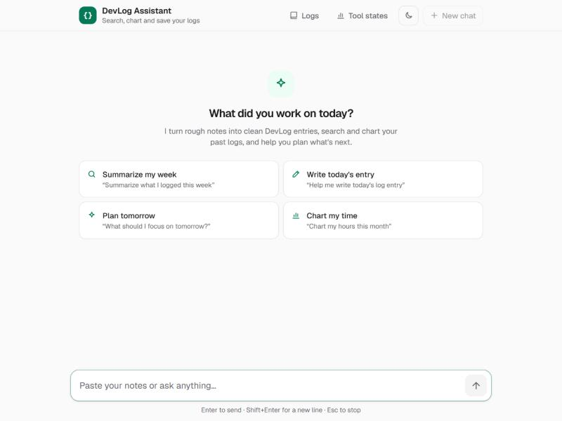

# DevLog Assistant

DevLog is a journal where developers write down their daily work. **DevLog
Assistant** is its AI chat: you paste rough notes about your day, and it turns
them into a clean log entry. It can also search your past entries, chart where
your hours went, and save a new entry after you approve it.

Replies stream in word by word, tool results show up as cards (lists, charts,
a save form), and every failure has a designed state: offline, rate limited,
the model busy, a reply cut off halfway, an empty reply.

**Live:** https://REPLACE-WITH-PRODUCTION-URL.vercel.app <!-- TODO: paste the production URL after `vercel --prod` -->

| Welcome | Tool card (search results) |
| --- | --- |
|  |  |
| **Rate limited (the abuse guard)** | **Phone (375 px)** |
|  |  |

---

## What you can do

| Ask something like | What happens |
| --- | --- |
| "Summarize what I logged this week" | Runs the `queryLogs` tool and shows the matching entries as a card |
| "Chart my hours this month" | Runs `getLogStats` and shows a bar chart (with a table view for screen readers) |
| "Help me write today's entry: fixed auth bug, paired with Sam on caching" | Writes the entry, then `saveLogEntry` asks you to **approve** it before saving |
| "What should I focus on tomorrow?" | A plain streamed answer, with the model's "Thought process" in a collapsible box |

Other pages: **/logs** lists every entry (filter by tag), **/states** shows
every tool card state side by side.

> The entries are sample data kept in server memory (there's no database yet).
> Entries you save survive while the server is warm and reset on a cold start.

---

## Run it locally

You need **Node.js 22** (20.9+ works) and npm.

```bash
git clone https://github.com/AqsaSaqib/FlyRank_Internship_Frontend_AI_Engineering.git
```

```bash
cd FlyRank_Internship_Frontend_AI_Engineering/Week8_Task/Production_deployment_and_README
```

```bash
npm install
```

```bash
npm run dev
```

Open http://localhost:3000. **No API key is needed to try it:** with no key
set, development uses a built-in mock model that streams scripted answers and
calls the real tools. To use a real model, copy `.env.example` to `.env.local`
and fill in **one** key, then restart `npm run dev`.

| Command | What it does |
| --- | --- |
| `npm run dev` | Dev server on port 3000 |
| `npm run build` then `npm start` | Production build, served locally |
| `npm run test:run` | Unit, component and route tests (Vitest, ~30 s) |
| `npm run test:e2e` | Builds the app and runs browser tests (Playwright, uses your installed Chrome) |
| `npm run check` | Lint + typecheck + build, what I run before every push |

No test ever calls a real AI provider: the test setup removes the keys and
wraps `fetch` so any request to Anthropic or Gemini fails the test.

---

## Environment variables

All of them are **server-only**. None start with `NEXT_PUBLIC_` (except the
dev-only sabotage flag), so no key can end up in the browser bundle.
`lib/ai/config.ts` imports `server-only`, so the build fails if a client
component ever imports it.

| Variable | Required | Default | What it does |
| --- | --- | --- | --- |
| `ANTHROPIC_API_KEY` | One of the two keys in production | – | Use Claude. Wins if both keys are set. |
| `GEMINI_API_KEY` | One of the two keys in production | – | Use Google Gemini (has a free tier). |
| `ANTHROPIC_MODEL` | No | `claude-opus-5` | Claude model id |
| `ANTHROPIC_FALLBACK_MODEL` | No | `claude-haiku-4-5` | Tried once if the main model returns 429/503/529. `none` turns it off. |
| `GEMINI_MODEL` | No | `gemini-flash-lite-latest` | Gemini model id |
| `GEMINI_FALLBACK_MODEL` | No | `gemini-3.5-flash-lite` | Same as above, for Gemini |
| `CHAT_PROVIDER` | No | picked from the keys | Force `anthropic`, `gemini` or `mock` |
| `CHAT_MOCK` | No | – | `1` = in production with no key, use the mock instead of showing a setup error |
| `CHAT_RATE_LIMIT` | No | on for real models, off for mock | `on` / `off` |
| `CHAT_RATE_LIMIT_PER_MINUTE` | No | `10` | Requests per IP per minute |
| `CHAT_RATE_LIMIT_PER_DAY` | No | `100` | Requests per IP per day |
| `CHAT_DAILY_BUDGET` | No | `1000` | Requests per day for the whole app, all visitors together |
| `DEVLOG_TOOL_LATENCY_MS` | No | `700` | Fake database delay, so the tools' "working" state is visible |
| `NEXT_PUBLIC_ENABLE_SABOTAGE` | **Never in production** | – | `true` enables `?sabotage=429` etc. to force each failure (see `docs/failure-inventory.md`) |

---

## Deploying (Vercel)

1. Import the repo in Vercel and set **Root Directory** to
   `Week8_Task/Production_deployment_and_README`. Framework: Next.js (detected).
2. In **Settings → Environment Variables**, add `ANTHROPIC_API_KEY` *or*
   `GEMINI_API_KEY` for **Production** (and Preview if you want previews to
   use a real model). Leave `NEXT_PUBLIC_ENABLE_SABOTAGE` unset.
3. Set a monthly **spend limit** in the Anthropic or Google AI console. The
   rate limiter stops trivial abuse; the provider's limit is the backstop.
4. Deploy, then promote: `vercel --prod` from this folder, or **Promote to
   Production** on a preview deployment. Rolling back is **Instant Rollback**
   on any earlier production deployment.

### Production checklist

- [ ] The production URL loads and the full flow works: send → stream → tool card → approve a save → see it on /logs
- [ ] Sending 11 messages inside a minute shows "Too many requests" with a countdown
- [ ] `?sabotage=429` does **nothing** in production (the flag is unset)
- [ ] Cross-browser pass: Chrome, Firefox, Safari (macOS), Safari on iPhone

The phone layout (keyboard, safe areas, `100dvh`) and Safari quirks were
handled in Week 5 (see `docs/failure-inventory.md`); this week I re-checked
the 375 px layout (no horizontal scroll) in the browser.

---

## Architecture

```
Browser                                     Server (Vercel function, Node)
───────                                     ──────────────────────────────
components/chat/Chat.tsx                    app/api/chat/route.ts   maxDuration = 60 s
  useChat (lib/chat/use-devlog-chat.ts)       1. same-origin check            → 403
  │                                           2. body ≤ 1,000,000 chars        → 413
  │  POST /api/chat  { messages }             3. zod + safeValidateUIMessages → 400
  └──────────────────────────────────────▶    4. empty / > 8,000 chars        → 400
                                              5. rate limit (per IP + daily)  → 429
  ◀── SSE: UI message stream ─────────────    6. streamText(model, tools, last 40 messages)
  text, reasoning, typed tool parts              │
  │                                              ├─ lib/ai/config.ts   provider, model, fallback, prompt
  ├─ Message.tsx / Markdown.tsx (streamdown)     ├─ lib/ai/tools.ts    queryLogs, getLogStats, saveLogEntry
  ├─ components/tools/*  (cards per tool)        ├─ lib/devlog/entries.ts  in-memory sample data
  └─ ChatError.tsx (one UI per error code)       └─ lib/ai/errors.ts   upstream error → { error, code, retryAfter }
```

- **One error contract** (`lib/chat/errors.ts`): every failure, whether an HTTP
  error before streaming or an error in the middle of the stream, is
  `{ error, code, retryAfter? }`. The UI switches on `code`, so a new failure
  only needs a new code and one line of copy.
- **Tools run on the server.** The model can take up to 5 steps per request
  (e.g. search → stats → answer). `saveLogEntry` pauses the stream for your
  approval; your Approve/Cancel is sent with the next request.
- **Stop really stops.** The browser's abort reaches `request.signal`, which
  cancels the provider request, so a stopped reply stops costing tokens.

### Abuse protection (`lib/ai/rate-limit.ts`)

The URL is public and every reply costs money, so the route refuses work it
shouldn't pay for, cheapest check first:

| Guard | Limit | Response |
| --- | --- | --- |
| Other websites calling the API from their visitors' browsers | `Origin` must match the host | 403 |
| Huge request bodies | 1,000,000 characters | 413 `too_long` |
| Long messages | 8,000 characters per message (the composer checks the same number) | 400 `too_long` |
| Long histories | Only the last 40 messages are sent to the model | – |
| Long answers | 4,096 output tokens per step, 5 steps, 55 s model timeout, `maxDuration` 60 s | – |
| One person sending fast | 10 requests / minute / IP | 429 `rate_limited` + `Retry-After` (the UI counts down) |
| One person all day | 100 requests / day / IP | 429 `quota_exceeded` |
| Everyone together | 1,000 requests / day | 429 `quota_exceeded` |

Invalid requests are rejected *before* the rate limiter, so they never use up
anyone's budget. The free mock model skips the limiter.

**Known limit:** the counters live in the function instance's memory. Vercel
reuses warm instances, so this stops someone holding Enter or looping `curl`,
but it isn't shared between instances. Someone spreading requests over many
IPs could get past it, which is why the provider spend limit (deploy step 3)
matters. The fix is swapping the `Map` for Upstash Redis; the function
signature (`checkRateLimit(clientId)`) wouldn't change.

---

## Decisions

| Decision | Why | Trade-off |
| --- | --- | --- |
| **Next.js route handler + Vercel AI SDK** | One `streamText` call works with Claude, Gemini and the mock; the SDK's UI message stream gives typed tool parts for free | Tied to the SDK's stream format |
| **Two providers + a mock** | Gemini's free tier for development, Claude for quality; the mock means anyone can run it with no key, and tests never spend tokens | Three code paths to keep in sync (they share one prompt and one tool set) |
| **Fallback model on 429/503/529** | Gemini's full Flash model often hit its free quota or was overloaded; trying Flash-Lite once fixed most of it | The reply may come from a smaller model (the model name is shown under each reply) |
| **`maxRetries: 1`** | A quota 429 doesn't clear in seconds, and each retry spends quota | A real blip gets one retry, then the user's Retry button |
| **In-memory rate limiter, not Redis** | No extra service or account for an internship project; covers trivial abuse | Not shared across instances (see "Known limit") |
| **Approval before saving** | The model must never write data the user didn't confirm | One extra click |
| **Tests find elements by role and label only** | Tests break only when something a user sees or hears changes; ESLint blocks `getByTestId`/`querySelector` in tests | Some components needed better labels first (which helped accessibility anyway) |
| **In-memory sample entries** | The brief is about the AI interaction, not a database | Saved entries reset on a cold start |

---

## Tests

66 unit/component/route tests and 4 Playwright browser tests.

| File | What it checks |
| --- | --- |
| `app/api/chat/route.test.ts` | Bad requests → 400, streaming, server-side tools, **the abuse guard** (403, 413, 429 `rate_limited`, 429 `quota_exceeded`, rejected requests don't use budget), no real AI calls |
| `lib/ai/rate-limit.test.ts` | Burst window and `retryAfter`, separate budgets per IP, daily reset, app-wide cap, IP parsing |
| `components/chat/*.test.tsx` | Messages, the composer, pending → streaming → done → error → retry |
| `components/tools/*.test.ts(x)` | Tool cards: loading, results, empty, error + retry; formatting helpers |
| `e2e/*.spec.ts` | The main flow and the error states in a real browser |

---

## How AI tools built this

I built DevLog Assistant over Weeks 4–8 with **Claude Code** (Anthropic's
coding agent) in the terminal and the Claude desktop app. I wrote the briefs,
made the product decisions and reviewed every change; Claude Code wrote most
of the code, ran the commands, and used the browser to check its own work.
What that looked like in practice:

**What it did well**

- **Week 5, error states.** I asked for a failure inventory *first*
  (`docs/failure-inventory.md`), then fixes. That order worked: it listed 13
  ways the chat could fail, and each became a designed state with a way to
  trigger it on purpose (`?sabotage=429`, `disconnect`, `malformed`, …). The
  history shows the steps as separate commits (`Step 1: failure inventory` →
  `Step 5: quality gates`).
- **Week 6, tests.** I broke the code on purpose by deleting
  `aria-invalid={tooLong}` from the composer. The AI ran the tests, saw
  `Expected: aria-invalid="false" Received: null`, decided the *test* was
  right, and fixed the code, not the test. The page looked identical with the
  bug; only screen readers lost the error.
- **Week 8, this rate limiter.** It found that `maxDuration` and the
  per-message cap already existed, and that the real gap was per-IP limits.
  It reused the existing `rate_limited` error code, so the UI's countdown and
  disabled Retry worked without any new client code. It then tripped the
  limit in the in-app browser (`CHAT_RATE_LIMIT_PER_MINUTE=2`), waited out the
  countdown, and confirmed Retry recovers.

**Where it went wrong, and what I changed**

- **Slow tests.** Its first rate-limit route test read three full mock
  replies in a row and timed out at 15 s, because the mock streams in real
  time. The fix was to check the status code and cancel the body
  (`response.body?.cancel()`), which also tests what matters.
- **Screenshots.** It first copied the Week 7 "after" screenshots into this
  README; on looking at them they were Lighthouse reports, not the app. It
  deleted them and took real ones from the running app instead.
- **Copy that didn't fit anymore.** The 429 notice said "The AI provider asked
  us to slow down", which became wrong once our own server could send 429s. It
  changed it to "Messages are being sent faster than the assistant allows."
- **Tests nobody re-ran.** Running the Playwright tests this week turned up 2
  failures that came in with Week 7. The accessibility pass changed tool cards
  from `<section>` to `<article>` and added a screen-reader announcement that
  repeats the reply, but the browser tests still looked for a `region` and
  matched the reply text twice. The app was right and the locators were out
  of date, so only the tests changed (`getByRole("article")`,
  `{ exact: true }`). Lesson: run `npm run test:e2e`, not only the unit tests,
  before calling a week done.
- **Not a complete fix.** An in-memory limiter isn't shared between server
  instances. Rather than call the route "protected", the README says what it
  doesn't cover ("Known limit" above) and puts the provider spend limit in the
  deploy steps.

**How I kept it on track**

- Each project folder has a `CLAUDE.md` → `AGENTS.md` telling the agent this
  is Next.js 16 and to read the bundled docs in `node_modules/next/dist/docs/`
  before writing code, because its training data has older Next.js APIs.
- `npm run check` (lint + typecheck + build) and `npm run test:run` had to pass
  before anything was committed.
- The test safety net (`test/ai-safety-net.ts`) means an AI-written test can't
  quietly start calling a paid API.

---

## Project history

This folder is the final, production version. Earlier stages are kept in the
same repo so the progress is visible:

| Week | Folder | What was added |
| --- | --- | --- |
| 3 | `Week3_Task/Capstone_Skeleton_Deployed` | DevLog app skeleton, routes, themes |
| 4 | `Week4_Task/Streaming_AI_Chat_Interface` | The streaming chat |
| 5 | `Week5_Task/Tool_results_and_structured_output_in_the_UI` | Server tools and tool cards |
| 5 | `Week5_Task/Errorstates_emptystates_edgecases` | Every failure state, mobile and Safari |
| 6 | `Week6_Task/Testing_Pass` | Vitest, Testing Library, Playwright |
| 7 | `Week7_Task/Accessibility_and_performance_audit` | Accessibility and performance audit |
| 8 | **this folder** | Abuse protection, production deploy, this README |

From Week 8 on, commits follow [Conventional Commits](https://www.conventionalcommits.org/en/v1.0.0/)
(`feat:`, `fix:`, `docs:`). I didn't rewrite the older history: it's already
public, and I checked that no secrets were ever committed.

## Tech

Next.js 16 (App Router, Turbopack), React 19, TypeScript, Tailwind CSS 4,
Vercel AI SDK 7 (`ai`, `@ai-sdk/anthropic`, `@ai-sdk/google`), Zod 4,
Streamdown, Vitest, React Testing Library, Playwright. Hosted on Vercel.
